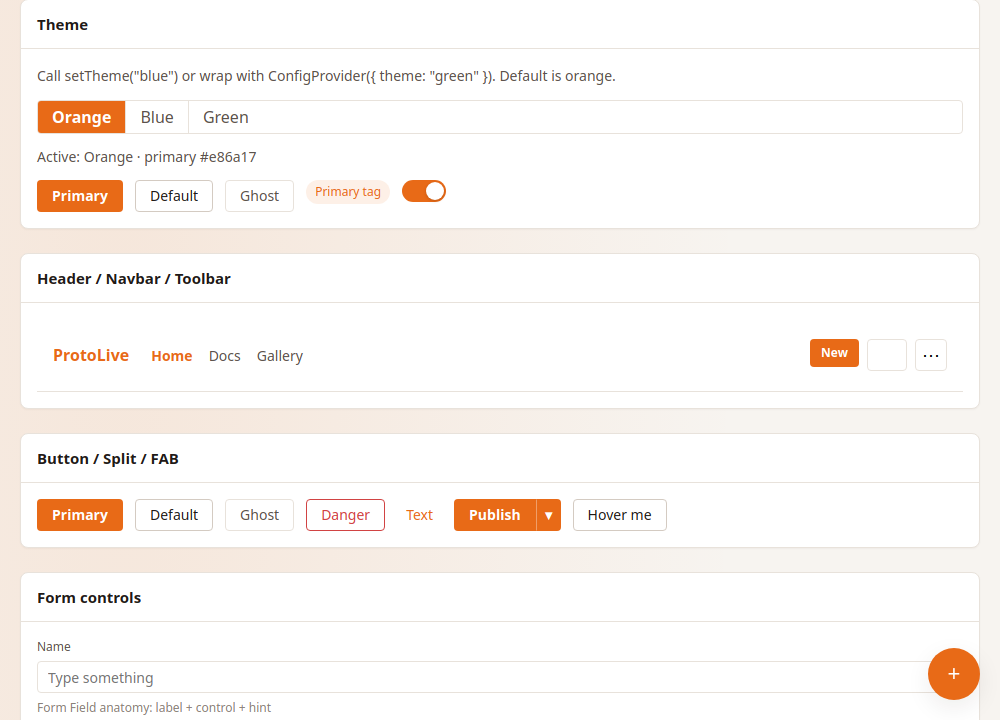
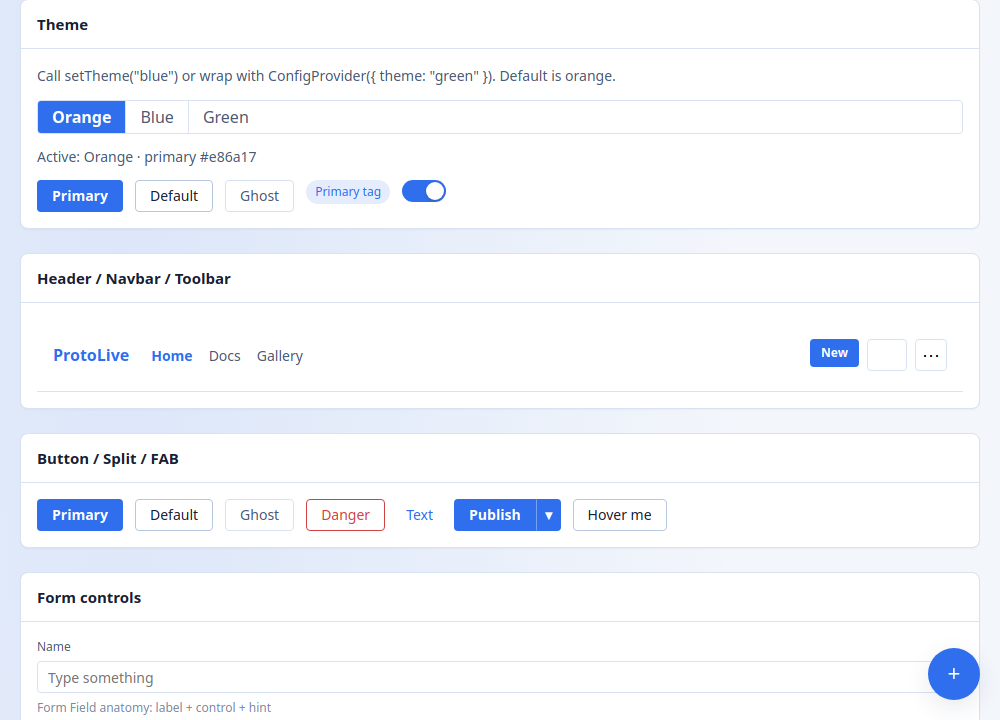
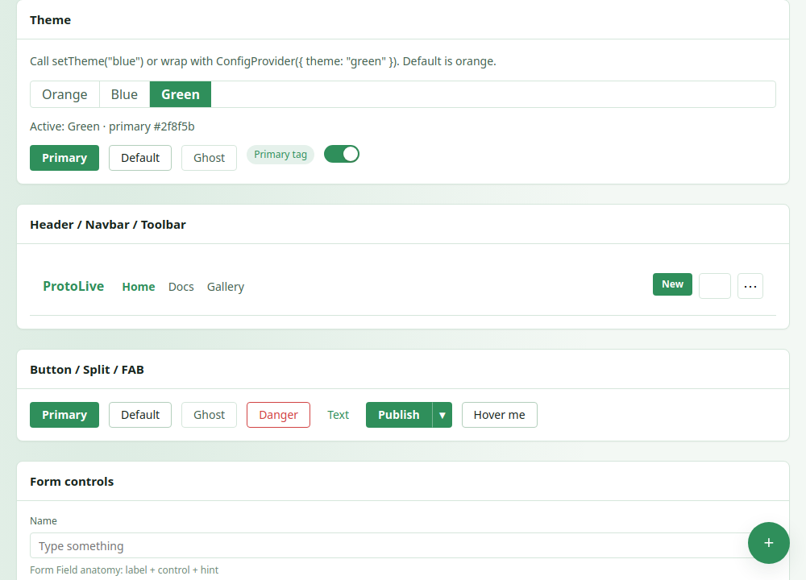
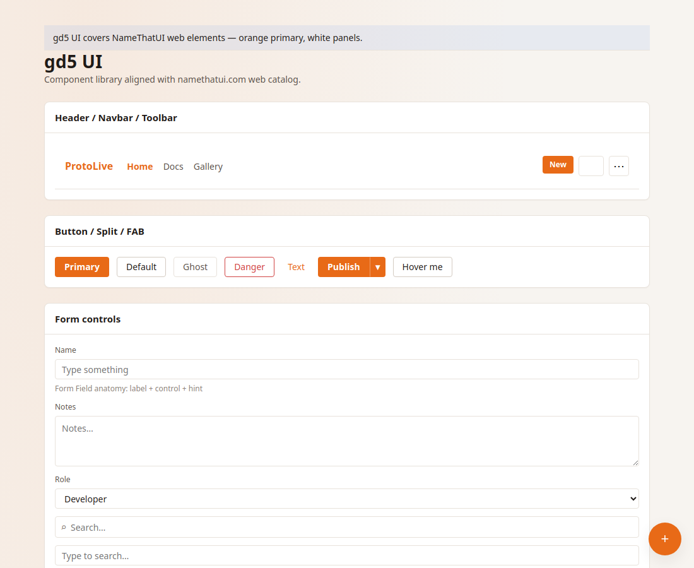
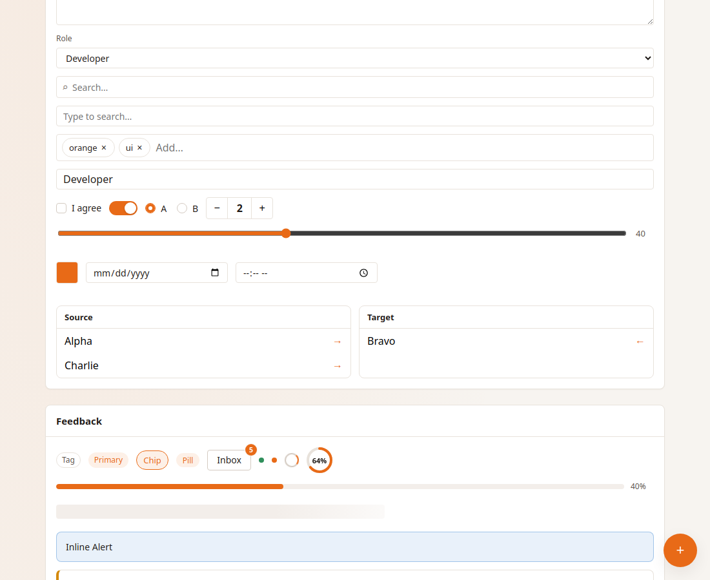
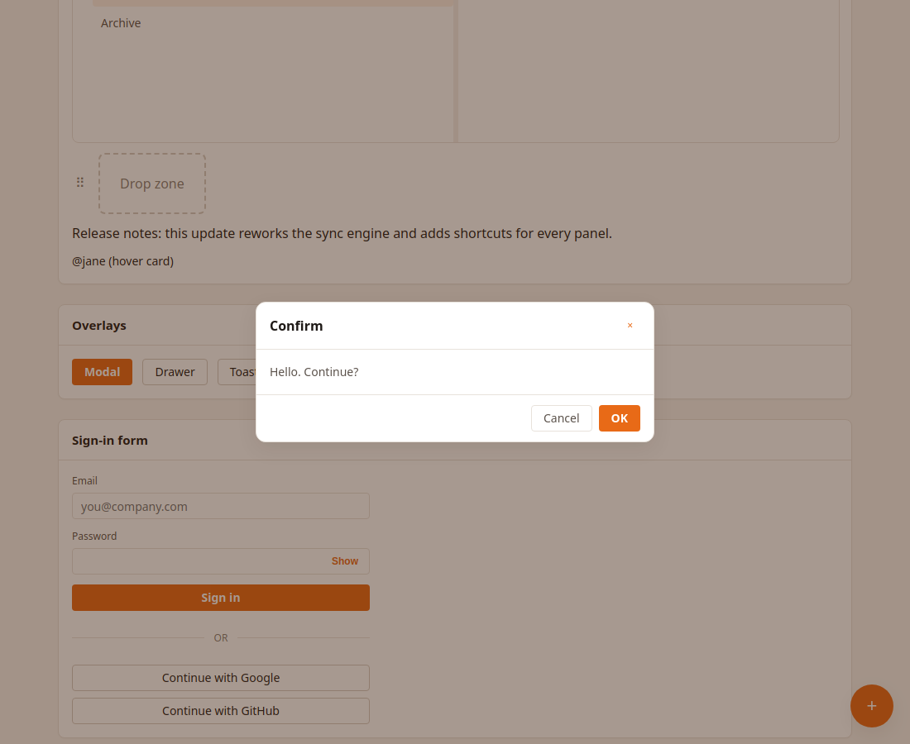

# gd5 Engine + UI

A minimal **real-DOM** component runtime for the browser — no virtual DOM, no bundler — plus an **antd-style UI kit** (`src/ui/`) with orange primary and **white panels**.

`src/product/` (ProtoLive) is **only a reference app**. Treat it as documentation by example, not the primary deliverable.

| Layer | Path | Docs |
|-------|------|------|
| Engine API | `src/engine/` | [`docs/api.md`](docs/api.md) |
| UI kit | `src/ui/` | [`docs/ui.md`](docs/ui.md) · gallery [`examples/ui-gallery.html`](examples/ui-gallery.html) |

[中文说明](#中文)

---

## Design goals

| Goal | Approach |
|------|----------|
| Small surface | `Component`, `ComponentRender`, `D` / `bind`, `LogProvider`, style adoption |
| Real DOM | Mutate elements directly; skip VDOM diff overhead |
| Zero build | `import` from `src/engine/index.js` / `src/ui/index.js` over HTTP |
| One lifecycle | Pages and nested UI both use `mount` / `unmount` |
| Hard to misuse | `ensureShell`, declarative `onClick`, co-located CSS, auto listener cleanup |
| Ready-made chrome | `src/ui` Button / Input / Modal… (orange theme by default) |

Inspired by the original gd5 mini framework; this tree is the ES-module evolution.

---

## Install / consume

There is **no package build step** and no required `dist/`. Use it like a module-native library (closer to “script tag + API” than to a React toolchain):

```html
<script type="module">
  import {
    Component,
    ComponentRender,
    bind,
    LogProvider,
  } from './src/engine/index.js';

  // your app…
</script>
```

Serve over HTTP (ES modules need a server):

```bash
python3 -m http.server 8080
# open http://localhost:8080
```

Optional later: publish an IIFE/UMD bundle for a global `gd5` if you want a single classic `<script src>` — not required for normal use.

---

## UI kit (component library)

```html
<link rel="stylesheet" href="./src/ui/css/ui.css">
<script type="module">
  import { Button, Card, Space, Modal } from './src/ui/index.js';
</script>
```

```js
Button({ type: 'primary', text: 'Save', onClick: () => this.save() })
```

Default palette is **orange primary + white panels**. Themes are selectable: **`orange` / `blue` / `green`**.

```js
import { setTheme, ConfigProvider, Button } from './src/ui/index.js';

setTheme('blue'); // document-wide
ConfigProvider({ theme: 'green' }, Button({ type: 'primary', text: 'Green' }));
```

Full catalog: [`docs/ui.md`](docs/ui.md). Live gallery: [`examples/ui-gallery.html`](examples/ui-gallery.html).

### Theme previews

| Orange (default) | Blue | Green |
|------------------|------|-------|
|  |  |  |







---

## Quick start (engine author / consumer)

### 1. Page slots in HTML

```html
<div id="home"></div>
<div id="settings" style="display:none"></div>

<script type="module" src="./app.js"></script>
```

### 2. Define a component

```js
import { Component } from './src/engine/index.js';

export class HomePage extends Component {
  static styles = new URL('./HomePage.css', import.meta.url);

  async componentDidMount() {
    this.state.data.title = 'Hello';
  }

  render() {
    this.ensureShell(
      (ids) => ids.root,
      ({ div, h1, button }) => {
        div(
          { id: 'root', className: 'home' },
          h1({ id: 'title', text: this.state.data.title }),
          button({
            id: 'btnNext',
            type: 'button',
            text: 'Settings',
            onClick: () => this.navigator.navigate('settings'),
          })
        );
      }
    );
    const { title } = this.ids();
    if (title) title.textContent = this.state.data.title;
  }
}
```

### 3. Wire navigation

**Same API everywhere:** after `super(deps)`, use `this.navigator` / `this.logger`.

- **Pages:** `ComponentRender.init` puts them into `deps` for you.
- **Children:** parent forwards them when constructing (still plain `new Child(deps)`).

```js
import { ComponentRender, LogProvider } from './src/engine/index.js';
import { HomePage } from './HomePage.js';
import { SettingsPage } from './SettingsPage.js';

const app = new ComponentRender({
  logProvider: new LogProvider({
    level: 'info',
    sink: 'console',
    context: { machId: 'local', userId: 'demo' },
  }),
});
app.init(
  { loading: 'home', home: 'home' },
  {
    home: HomePage,                                      // id defaults to "home"
    settings: { type: SettingsPage, isModal: true },     // only declare what differs
  }
);

window.addEventListener('DOMContentLoaded', () => app.render());
```

```js
// page — already has this.navigator
this.toolbar = new ToolbarComponent({
  navigator: this.navigator,
  logger: this.logger,
  store: this.store,
});

// child — identical usage
this.navigator.navigate('preview', { doc });
```

---

## Core concepts

### Lifecycle (pages and children share this)

```
mount(host) / navigate
  → adoptStyles (static styles)
  → componentDidMount(params)
  → render()
  → componentDidAttachEvents()   // window / document only; prefer on* in render

unmount / goBack
  → componentDidUnMount()        // business cleanup only
  → engine: remove on() listeners, clear host, reset refs
```

### Authoring checklist

1. `extends Component` — `state`; **pages** also get `this.navigator` / `this.logger` from `init`.
2. Co-locate CSS: `static styles = new URL('./X.css', import.meta.url)`.
3. Build UI with `ensureShell` / `paint` + `bind` helpers — not hand-rolled `createElement` trees.
4. Put DOM handlers in props: `onClick`, `onChange`, `onPointerDown`, … (or `events: { click: fn }`).
5. Use `this.on(window, 'keydown', …)` only for non-tree targets.
6. After mount, update with `setData` / `refresh` — do not re-`navigate` to refresh.
7. Nest with `new Child({ navigator: this.navigator, logger: this.logger, … })` so the child uses the same `this.navigator` API.

### Composition

Parent paints host slots, children `mount`:

```js
// parent render
div({ id: 'host-panel', className: 'component-host' });

// after shell exists
await this.panel.mount('host-panel');
```

Hosts often use `display: contents` so the child’s root participates in the parent layout grid.

### Declarative DOM (`D` / `bind`)

```js
const { div, button, map, get } = bind();

div(
  { className: 'list', id: 'list' },
  ...map(
    items,
    (item, _i, key) =>
      button({ key, className: 'item', text: item.label, onClick: () => select(item) }),
    (item) => item.id
  )
);

const [ref, root] = get();
```

Inside a `Component`, prefer `ensureShell` / `paint` so you rarely call `get` + `append` yourself.

### Styles

| Layer | Where |
|-------|--------|
| Design tokens / reset / shared primitives | App-level CSS (e.g. tokens + base) |
| Component-private rules | `FooComponent.css` next to `FooComponent.js` |

`mount` injects `static styles` once per URL/text key. Unmount does **not** remove styles (shared across remounts).

---

## Repository layout

```
src/engine/          ← runtime (primary)
src/ui/              ← component library (Button, Input, Modal…; orange theme)
src/product/         ← example app (ProtoLive), optional
examples/            ← ui-gallery.html
docs/                ← api.md, ui.md, engine.md, architecture.md
test/run.mjs
index.html           ← boots example product
```

Further reading:

- [`docs/api.md`](docs/api.md) — engine API reference
- [`docs/ui.md`](docs/ui.md) — UI kit catalog & theming
- [`docs/engine.md`](docs/engine.md) — authoring guide, pitfalls
- [`docs/architecture.md`](docs/architecture.md) — engine / UI / product boundary
- [`skills/engine/README.md`](skills/engine/README.md) — short authoring skill sheet

---

## Example product (optional)

ProtoLive under `src/product/` shows a full editor composed of engine components (toolbar, palette, artboard, inspector). Useful to see composition, co-located CSS, and declarative events in a real UI.

```bash
python3 -m http.server 8080
# http://localhost:8080  → example product

node test/run.mjs
```

You can delete or ignore `src/product/` when embedding the engine in your own app.

---

## Testing

```bash
node test/run.mjs
```

No bundler; tests exercise engine APIs and guard example-product invariants.

---

## License

MIT

---

## 中文

**gd5** = **引擎**（迷你实 DOM 运行时）+ **组件库**（`src/ui/`，对标 antd；**白面板**，主题可选 **橙 / 蓝 / 绿**）。`src/product/` 只是示例应用。

### 怎么用

```html
<link rel="stylesheet" href="./src/ui/css/ui.css">
<script type="module">
  import { Component, ComponentRender } from './src/engine/index.js';
  import { Button, Modal } from './src/ui/index.js';
</script>
```

静态服务器打开即可。画廊：[`examples/ui-gallery.html`](examples/ui-gallery.html)。主题：`setTheme('blue'|'green'|'orange')`。

| 橙（默认） | 蓝 | 绿 |
|------------|----|----|
|  |  |  |


### 开发者要点

- 页面 / 子组件共用 `mount`；页面默认有 `this.navigator`，子组件由父写入 deps
- 常用 UI 用 `src/ui`，不要手写一堆 `div.btn`
- **API**：[`docs/api.md`](docs/api.md) · **组件库**：[`docs/ui.md`](docs/ui.md)

### 示例与测试

```bash
python3 -m http.server 8080   # 打开示例产品
node test/run.mjs
```

嵌入自有应用时，只需依赖 `src/engine/`。
